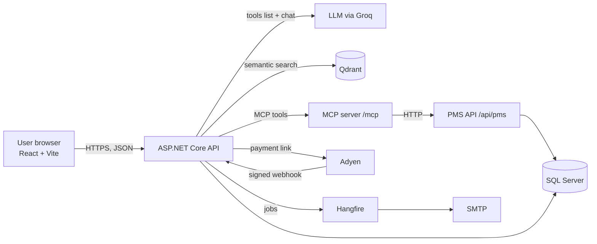
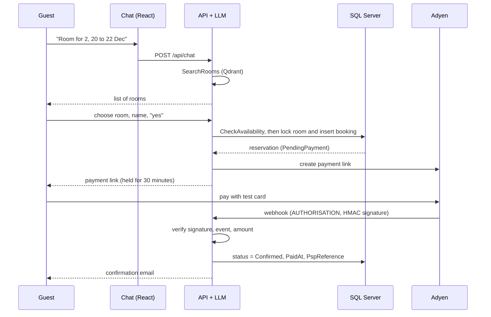

# StayGenie

**AI-powered hotel reservation and management platform.**

Guests chat with an assistant in plain English ("a room for 2, 20 to 22 Dec, under 20,000"), the assistant finds matching rooms with semantic search, creates the booking and sends a payment link. When the payment succeeds, a signed webhook confirms the booking and a confirmation email goes out. Customers manage their bookings and reviews in a dashboard, and admins get an overview of the whole system.

[](https://github.com/Mayakhan-gif/StayGenie/actions/workflows/ci.yml)


> **Note:** Payments run in Adyen's **test mode** only. No real money is ever charged. Use only Adyen's test cards.

---

## Table of contents

1. [Screenshots](#screenshots)
2. [Features](#features)
3. [Tech stack](#tech-stack)
4. [Architecture](#architecture)
5. [How a booking works](#how-a-booking-works)
6. [AI assistant](#ai-assistant)
7. [Authentication and authorization](#authentication-and-authorization)
8. [Payments (Adyen)](#payments-adyen)
9. [Background jobs and email](#background-jobs-and-email)
10. [Security](#security)
11. [Project structure](#project-structure)
12. [Database overview](#database-overview)
13. [API overview](#api-overview)
14. [Configuration and secrets](#configuration-and-secrets)
15. [Getting started](#getting-started)
16. [Testing](#testing)
17. [CI/CD](#cicd)
18. [Known limitations](#known-limitations)
19. [Future improvements](#future-improvements)
20. [Author](#author)

---

## Screenshots

<!-- Add your screenshots to docs/screenshots/ and keep these paths, or edit them. -->

| Chat and booking | Adyen payment page |
|---|---|
|  |  |

| My bookings | Admin dashboard |
|---|---|
|  |  |

| Swagger API documentation | GitHub Actions CI |
|---|---|
|  |  |

---

## Features

**Guest and customer**
- Chat assistant that understands natural language, searches rooms by meaning and creates bookings
- Live availability check against the database before every booking
- Booking with online payment (Adyen test mode) and email confirmation
- Booking works without an account; registered users also get **My bookings**
- Register, sign in and sign out with JWT authentication
- **My bookings** dashboard: summary numbers, status badges, cancel (when allowed), write a review after a completed stay
- Reviews and ratings (one review per completed booking)
- Hotels and rooms browsing

**Admin**
- Admin dashboard: hotels, rooms, customers, total and today's bookings, confirmed / pending / cancelled / expired counts, revenue and occupancy
- Lists of bookings, customers and reviews, with review moderation
- Manage hotels and rooms through the API (create, update, deactivate)

**Platform**
- Booking status flow: `PendingPayment` -> `Confirmed` / `Cancelled` / `Expired`
- Protection against double booking (per-room database lock inside a transaction)
- Signed webhook confirmation (HMAC verification, amount check, idempotent handling)
- Background jobs (Hangfire): confirmation email, automatic expiry of unpaid bookings
- Role-based authorization (Customer, Admin), rate limiting, restricted CORS, global error handling
- Swagger / OpenAPI documentation
- Unit tests and a GitHub Actions CI pipeline

---

## Tech stack

| Layer | Technology |
|---|---|
| Frontend | React, Vite, react-markdown |
| Backend | ASP.NET Core Web API (.NET 8), C# |
| Database | SQL Server (LocalDB for development), Entity Framework Core |
| Vector search | Qdrant (Docker), local embeddings (`SmartComponents.LocalEmbeddings`) |
| AI | LLM through Groq's OpenAI-compatible API, function calling via `Microsoft.Extensions.AI` |
| AI tools protocol | Model Context Protocol (MCP) server and client |
| Payments | Adyen Pay by Link (test mode) |
| Background jobs | Hangfire (SQL Server storage) |
| Email | SMTP (Papercut SMTP for local testing) |
| Auth | JWT bearer tokens, PBKDF2 password hashing |
| Testing | xUnit |
| CI | GitHub Actions |
| Tooling | Swagger / OpenAPI, ngrok (local webhook testing), Docker |

---

## Architecture



**Key design decisions**

- **The AI never decides facts.** It understands the request and picks tools. Rooms come from Qdrant, availability and bookings come from SQL Server, and the user id is overwritten from the JWT in code, never trusted from the model.
- **Qdrant is for searching only.** The source of truth for availability and bookings is SQL Server.
- **A booking is confirmed only by the Adyen webhook**, never by a browser redirect.
- **Payment and email sit behind interfaces** (`IPaymentService`, `IEmailService`), so a provider can be replaced without touching the controllers.
- **Booking rules live in one class** (`BookingRules`) so they are shared by the API and covered by unit tests.

---

## How a booking works



Booking statuses:

| Status | Meaning |
|---|---|
| `PendingPayment` | Booking created, room held, waiting for payment |
| `Confirmed` | Payment confirmed by the Adyen webhook |
| `Cancelled` | Cancelled by the user or an admin, or payment could not be started |
| `Expired` | Payment window (30 minutes) ended; a Hangfire job released the room |

**Double booking protection.** Creating a reservation takes an exclusive SQL application lock for that room (`sp_getapplock`), re-checks availability and inserts the booking in one transaction. Concurrent requests for the same room are serialized, so the second one receives `409 Conflict`.

---

## AI assistant

The chat endpoint (`POST /api/chat`) gives the LLM a system prompt and four tools:

| Tool | Source | Purpose |
|---|---|---|
| `SearchRooms` | Qdrant (direct tool) | Semantic room search from the user's wording, guests and budget |
| `CheckAvailability` | MCP -> PMS API -> SQL Server | Live availability for a room and date range |
| `CreateReservation` | MCP -> PMS API -> SQL Server | Creates a `PendingPayment` booking and returns a payment link |
| `GetReservation` | MCP -> PMS API -> SQL Server | Returns a booking's status; requires **both** reservation id and guest name |

Safeguards:

- The system prompt forbids inventing rooms, prices or availability and requires a summary and an explicit "yes" before booking.
- The assistant must not call a booking "confirmed" until a lookup shows `Confirmed`.
- `userId` is injected from the JWT by a wrapper around the `CreateReservation` tool, so the model cannot book on behalf of someone else.
- The PMS booking endpoint only trusts a `userId` when the call carries the internal `X-Internal-Key` header.
- Requests are validated and rate limited (message count and length).

Semantic search: every room description is converted to a 384-dimension embedding locally and indexed in Qdrant at startup. The user's query is embedded the same way and the nearest rooms are returned.

---

## Authentication and authorization

- Passwords are hashed with **PBKDF2** (SHA-256, 100,000 iterations, random salt). Plain passwords are never stored.
- Login returns a **JWT** (8 hours) containing the user id, name, email and role.
- Roles: `Customer` (default for every registration) and `Admin` (assigned directly in the database).
- Endpoints are protected on the server with `[Authorize]` and `[Authorize(Roles = "Admin")]`. Hiding buttons in the UI is only a convenience.
- `/api/me/*` always uses the user id from the token, never from the request.

Create an admin:

```sql
UPDATE Users SET Role = 'Admin' WHERE Email = 'you@example.com';
```

Then sign out and sign in again so the new token carries the new role.

---

## Payments (Adyen)

StayGenie uses Adyen **Pay by Link** in test mode. The backend creates a payment link for each booking (`reference = StayGenie-<reservationId>`, amount in minor units, 30-minute expiry) and gives it to the guest. Card data is entered on Adyen's hosted page and never reaches this server.

**Webhook:** `POST /api/payments/adyen-webhook`

1. Verify the **HMAC signature** of the notification with the HMAC key (constant-time comparison). Invalid signature -> `401`.
2. Accept only `AUTHORISATION` events with `success = true` for references starting with `StayGenie-`.
3. Check that the paid **amount and currency** match the booking.
4. Handle the event **idempotently** (an already confirmed booking is left untouched).
5. If the payment arrives after the booking expired, confirm it only when the room is still free; otherwise log that a refund is needed.
6. Set `Confirmed`, `PaidAt`, `PspReference` and enqueue the confirmation email.
7. Respond `[accepted]`.

Adyen test card (test mode only):

| Field | Value |
|---|---|
| Card number | `4111 1111 1111 1111` |
| Expiry | `03/30` |
| CVC | `737` |

---

## Background jobs and email

Hangfire stores jobs in the same SQL Server database. The dashboard is available at `/hangfire` in the Development environment, from the local machine only.

| Job | Type | Purpose |
|---|---|---|
| `SendConfirmationAsync` | Fire-and-forget | Sends the booking confirmation email after payment |
| `expire-pending-reservations` | Recurring (every 5 minutes) | Marks unpaid bookings as `Expired` after the hold time, releasing the room |

Email is sent through `IEmailService` (SMTP). For local development, [Papercut SMTP](https://github.com/ChangemakerStudios/Papercut-SMTP) captures all emails on `localhost:25` without sending anything. Guest names are HTML-encoded in the email body and logs contain reservation ids, not email addresses.

---

## Security

- PBKDF2 password hashing with salt; JWT with expiry and signature validation
- Role-based authorization enforced on the server
- Secrets kept out of source control (`dotnet user-secrets`, environment variables or CI secrets)
- CORS limited to configured origins (`Cors:Origins`, default `http://localhost:5173`)
- Rate limiting: authentication endpoints (10 requests per minute per IP) and chat (20 per minute per IP)
- Input validation on request DTOs and in the booking rules
- `GetReservation` needs reservation id **and** guest name; a wrong combination returns the same "not found" answer
- Webhook protected by HMAC verification plus amount and currency checks
- Global exception handler returns a safe `ProblemDetails` response with a trace id; details stay in the logs
- Card data is handled only by Adyen; no card data is stored

---

## Project structure

```
StayGenie/
|-- .github/workflows/ci.yml        CI pipeline (backend + frontend)
|-- StayGenie/                      ASP.NET Core Web API
|   |-- Controllers/                Auth, Chat, Pms, Payments, Rooms, Hotels, Reviews, Me, Admin
|   |-- Data/                       EF Core DbContext and entities (Room, Reservation, User, Review, Hotel)
|   |-- Services/                   BookingRules, JWT, password hashing, search, MCP tools,
|   |                               payment (Adyen), email, Hangfire jobs, exception handler
|   |-- Migrations/                 EF Core migrations
|   |-- Program.cs                  Service registration and middleware
|   `-- appsettings.json            Non-secret configuration
|-- StayGenie.Tests/                xUnit tests
|-- staygenie-ui/                   React + Vite frontend
|   `-- src/                        App, AuthPage, MyBookings, AdminDashboard, api helper, styles
`-- README.md
```

---

## Database overview

| Table | Purpose |
|---|---|
| `Users` | Accounts: name, unique email, password hash, role |
| `Hotels` | Hotels: name, city, address, amenities, active flag |
| `Rooms` | Rooms: number, type, price per night, capacity, amenities, hotel, active flag |
| `Reservations` | Bookings: room, dates, guests, guest name and email, total price, status, `UserId` (nullable), payment fields (`PaymentLinkId`, `PspReference`, `PaidAt`), `ReminderSentAt` |
| `Reviews` | Rating and comment per completed reservation (unique per reservation) |
| `Hangfire.*` | Background job storage (created by Hangfire) |

Relationships: a hotel has many rooms, a room has many reservations, a user has many reservations (optional, guest bookings have no user), a reservation has at most one review. Money columns use `decimal(10,2)`; the reservation status is stored as text.

---

## API overview

Interactive documentation is available at `https://localhost:7115/swagger`.

| Area | Endpoints | Access |
|---|---|---|
| Auth | `POST /api/auth/register`, `POST /api/auth/login` | Public (rate limited) |
| Chat | `POST /api/chat` | Public (rate limited); token optional |
| Rooms | `GET /api/rooms` | Public |
| Rooms | `POST /api/rooms`, `DELETE /api/rooms/{id}` | Admin |
| Hotels | `GET /api/hotels`, `GET /api/hotels/{id}` | Public |
| Hotels | `POST`, `PUT`, `DELETE /api/hotels/{id}` | Admin |
| Booking (PMS) | `GET /api/pms/availability`, `POST /api/pms/reservations`, `GET /api/pms/reservations/{id}?guestName=` | Public |
| Booking (PMS) | `GET /api/pms/reservations`, `DELETE /api/pms/reservations/{id}` | Admin |
| Payments | `POST /api/payments/adyen-webhook` | Adyen only (HMAC verified) |
| Reviews | `POST /api/reviews` | Signed-in customer |
| Reviews | `GET /api/reviews/room/{id}`, `GET /api/reviews/hotel/{id}` | Public |
| Reviews | `DELETE /api/reviews/{id}` | Admin |
| Me | `GET`, `PUT /api/me`, `POST /api/me/change-password`, `GET /api/me/summary`, `GET /api/me/reservations`, `GET /api/me/reservations/{id}`, `POST /api/me/reservations/{id}/cancel`, `GET /api/me/reviews` | Signed-in user |
| Admin | `GET /api/admin/stats`, `/customers`, `/reservations`, `/reviews` | Admin |
| MCP | `/mcp` | Internal (used by the chat client) |
| Hangfire | `/hangfire` | Development, local machine only |

---

## Configuration and secrets

Non-secret settings live in `appsettings.json`. **Secrets are never committed.** For local development use `dotnet user-secrets`; in CI or deployment use environment variables or GitHub Secrets (nested keys use `__`, for example `Adyen__ApiKey`).

| Key | Purpose |
|---|---|
| `Jwt:Key` | JWT signing key (at least 32 characters) |
| `Groq:ApiKey` | LLM provider API key |
| `ConnectionStrings:Hotel` | SQL Server connection string (LocalDB by default) |
| `Adyen:ApiKey` | Adyen API key |
| `Adyen:ClientKey` | Adyen client key (for a future embedded checkout) |
| `Adyen:MerchantAccount` | Adyen merchant account name |
| `Adyen:HmacKey` | Webhook HMAC key |
| `Internal:ApiKey` | Shared key that lets the PMS API trust the `userId` sent by the app itself |
| `Email:Username`, `Email:Password` | Only when using a real SMTP provider |
| `Cors:Origins` | Allowed frontend origins (optional, defaults to `http://localhost:5173`) |

Frontend: `VITE_API_URL` (optional, defaults to `https://localhost:7115`).

Generate random keys, for example in PowerShell:

```powershell
$key = [Convert]::ToBase64String((1..48 | ForEach-Object { Get-Random -Maximum 256 }) -as [byte[]])
dotnet user-secrets set "Jwt:Key" $key
```

---

## Getting started

### Prerequisites

- [.NET 8 SDK](https://dotnet.microsoft.com/download) and the `dotnet-ef` tool (`dotnet tool install --global dotnet-ef`)
- [Node.js](https://nodejs.org/) 22
- SQL Server LocalDB (installed with Visual Studio) or another SQL Server
- [Docker Desktop](https://www.docker.com/) (for Qdrant)
- A Groq API key
- An Adyen test account (merchant account, API credential, webhook with HMAC key)
- [Papercut SMTP](https://github.com/ChangemakerStudios/Papercut-SMTP) (optional, to inspect emails)
- [ngrok](https://ngrok.com/) (only to test the Adyen webhook locally)

### 1. Clone

```bash
git clone https://github.com/Mayakhan-gif/StayGenie.git
cd StayGenie
```

### 2. Start Qdrant

```bash
docker run -d --name qdrant -p 6333:6333 -p 6334:6334 qdrant/qdrant
```

### 3. Backend

```bash
cd StayGenie
dotnet user-secrets init   # only if the project has no UserSecretsId yet

dotnet user-secrets set "Jwt:Key" "<random key, 32+ characters>"
dotnet user-secrets set "Groq:ApiKey" "<your Groq key>"
dotnet user-secrets set "Adyen:ApiKey" "<your Adyen API key>"
dotnet user-secrets set "Adyen:ClientKey" "<your Adyen client key>"
dotnet user-secrets set "Adyen:MerchantAccount" "<your merchant account>"
dotnet user-secrets set "Adyen:HmacKey" "<your webhook HMAC key>"
dotnet user-secrets set "Internal:ApiKey" "<random key>"

dotnet ef database update
dotnet run --launch-profile https
```

The API listens on `https://localhost:7115` (Swagger at `/swagger`). On startup it indexes all rooms in Qdrant, so Qdrant must be running.

> The local development URL `https://localhost:7115` is currently set in `Program.cs` and the MCP client; change both if you use a different port.

### 4. Frontend

```bash
cd staygenie-ui
npm install
npm run dev
```

Open `http://localhost:5173`.

### 5. Email (local)

Start Papercut SMTP. The default settings (`localhost`, port `25`) already point to it, and every email the app sends appears in its window.

### 6. Adyen webhook (local)

Adyen must be able to reach the backend, so expose it with a tunnel:

```bash
ngrok http https://localhost:7115
```

In the Adyen Customer Area (**Developers -> Webhooks**), create a standard webhook with the URL:

```
https://<your-ngrok-address>/api/payments/adyen-webhook
```

Generate the HMAC key, store it as `Adyen:HmacKey` and restart the backend. The free ngrok address changes every time ngrok restarts, so update the webhook URL when it does.

### 7. Try it

1. Register and sign in.
2. Ask the assistant for a room, choose one, give a name and confirm with "yes".
3. Open the payment link and pay with the test card above.
4. Within seconds the booking becomes `Confirmed` and the email appears in Papercut.
5. Open **My bookings**. To try the Admin dashboard, promote your user (see [Authentication](#authentication-and-authorization)).

---

## Testing

```bash
dotnet test StayGenie.Tests
```

The unit tests cover:

- `BookingRules`: date validation, maximum stay, guest capacity, price calculation, cancellation and review rules
- `PasswordHasher`: no plain text, correct/incorrect password, unique salt per hash
- `JwtTokenService`: role and user id claims, issuer and audience, expiry, no password hash in the token

Manual end-to-end checklist: register and sign in, chat booking, payment with the test card, webhook confirmation, confirmation email, My bookings and cancel, review after a completed stay, Admin dashboard, and the security checks (`401` without a token, `403` for a customer on admin endpoints, wrong name on booking lookup).

---

## CI/CD

GitHub Actions (`.github/workflows/ci.yml`) runs on every push to `main` and on every pull request targeting `main`:

| Job | Runner | Steps |
|---|---|---|
| Backend | `windows-latest` | checkout, set up .NET 8, restore, build, run unit tests |
| Frontend | `ubuntu-latest` | checkout, set up Node 22, `npm ci`, `npm run build` |

Work is done on feature branches and merged through pull requests, so the CI result is visible before anything reaches `main`.

Continuous deployment is not set up yet (see below).

---

## Known limitations

- The `/mcp` endpoint is not authenticated yet; it should be protected with a shared secret.
- Swagger is enabled in every environment and some local URLs (API, Qdrant) are hard-coded; both should move to configuration for production.
- Refunds are not automated; a late payment or a cancelled paid booking is logged for manual refund in the Adyen Customer Area.
- The JWT is kept in `localStorage`; an HttpOnly cookie would be safer in production.
- Guest bookings are not email-verified.
- There are unit tests only; integration and end-to-end tests are still missing.
- The app is not deployed. Cloud hosting for SQL Server, Qdrant and a public webhook address is paid, so it runs locally (with ngrok for webhooks).
- The frontend does not yet have admin screens for creating hotels and rooms (available through the API).

---

## Future improvements

- Deployment (container images, hosted database and Qdrant) and a CD stage in GitHub Actions
- Admin UI to manage hotels and rooms
- Automatic refunds through the Adyen API
- Check-in reminder emails (the `ReminderSentAt` column and job design are in place)
- Embedded Adyen Drop-in checkout
- Integration and end-to-end tests
- Email verification for guest bookings and a password reset flow
- Secure the MCP endpoint and move to HttpOnly cookies
- Structured logging and monitoring

---

## Author

<!-- Replace the placeholders below. -->

**[Your name]**  
GitHub: [@Mayakhan-gif](https://github.com/Mayakhan-gif)  
LinkedIn: [www.linkedin.com/in/maryam-bibi01]  
Email: [mk5214543@gmail.com]

*StayGenie is a portfolio project. Payments run in test mode only.*
